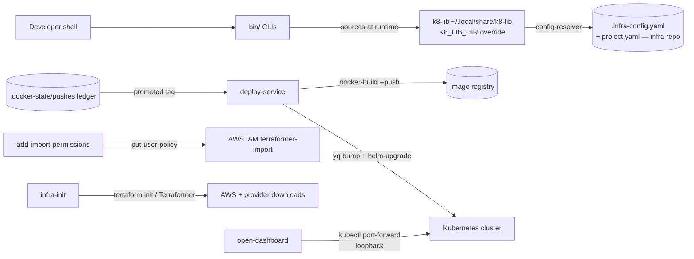

# infra-utils — Threat Model

## Overview

`infra-utils` is a single-operator developer toolchain: six bash CLIs that run on a
workstation with the operator's own credentials and act on external systems (AWS IAM,
a container registry, the Kubernetes cluster via helm, Terraform). There is **no
server, no web listener, and no multi-tenant surface** — every trust boundary is a
crossing from the developer's shell outward. The crown jewels are the credentials the
scripts exercise transitively (AWS keys, registry creds, kubeconfig) and the deploy
authority they carry: whoever controls these scripts, their config inputs, or
`K8_LIB_DIR` controls what gets built, pushed, and deployed to the cluster.

→ *Components and pipeline: [PROJ-ARCH.md](PROJ-ARCH.md) · directories: [PROJ-LAYOUT.md](PROJ-LAYOUT.md)*

## Attack Surface

All scripts execute external code by design: they source k8-lib (`K8_LIB_DIR`,
env-overridable) and shell out to `docker-build`, `helm-upgrade`, `terraform`, `aws`,
and `yq` found on `PATH`. Config inputs are plain YAML files in the infra repo —
write access there is deploy authority. No secrets are stored or printed by this
repo; credentials are consumed transitively by the shelled-out CLIs from the caller's
environment (see [PROJ-SCHEMA.md](PROJ-SCHEMA.md) § 4).

## Vulnerability Register

| ID | Severity | STRIDE | Component | Status |
|----|----------|--------|-----------|--------|
| T-001 | Medium | Elevation of privilege | `K8_LIB_DIR` env override sources arbitrary shell into every CLI at startup | Open (accepted — local machine trust) |
| T-002 | High | Tampering (supply chain) | Tag promoted from `.docker-state/pushes` is written into chart values and shipped; a compromised build/registry ships attacker images | Partial (mitigations live outside this repo: registry ACLs, base-image hygiene) |
| T-003 | Medium | Elevation of privilege | `add-import-permissions` replaces the `terraformer-import` user's inline IAM policy; a hijacked AWS profile can widen it | Partial (canonical policy JSON reviewed in the terraform repo; `--dry-run` available) |
| T-004 | Medium | Tampering | `.infra-config.yaml` / `project.yaml` are plain repo files; write access = arbitrary chart/values targets for deploys | Partial (normal repo review gates; no schema validation of deploy wiring) |
| T-005 | Low | Spoofing / Repudiation | Promoted-tag ledger `.docker-state/pushes` is an unauthenticated local file; tampering pins a wrong (not necessarily malicious) tag | Open (accepted — consistency risk, not integrity of cluster) |
| T-006 | Low | Information disclosure | Local artifacts (`values.yaml` bumps, ledger) record internal image names/shas | Mitigated (no secrets in artifacts; nothing published by this repo) |
| T-007 | Low | Information disclosure | `open-dashboard` exposes dashboard ports locally | Mitigated (`kubectl port-forward` default loopback bind; no `--address` override passed) |

## Mitigation Coverage

2 mitigated · 3 partial · 2 open. No secrets are read, stored, or logged by these
scripts (verified against source); every script runs `set -euo pipefail` and none
use `eval` or network fetches directly — external effects are delegated to the
audited sibling CLIs. Open/partial items depend on workstation and registry trust,
which this repo cannot enforce from the inside.

## Residual Risk

Accepted: the operator's workstation is in the TCB. `K8_LIB_DIR`/`PATH` poisoning,
infra-repo write access, or a compromised registry all collapse to "deploy anything"
— inherent to a credentials-holding operator toolchain with no server-side gate.
`deploy-one-off` ships as an editable template (not runnable as-is), so it adds no
direct surface.
